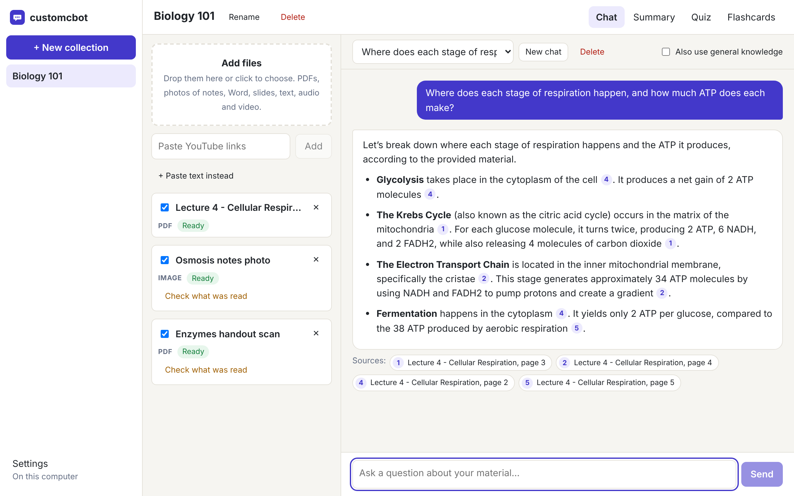

# customcbot

A free chatbot you teach with your own material. Add PDFs, lecture videos, slides or photos of handwritten notes, then ask questions, get study guides, and revise with quizzes and flashcards.

Everything runs on your own computer. There is no account, no subscription, and nothing you add is uploaded anywhere.



## What it does

- **Chat with your material.** Answers come from what you added, and each one links back to the exact page or video moment it came from.
- **Reads many formats.** PDF (including scans), Word, PowerPoint, text, images and photos of handwriting, audio and video files, and YouTube links or playlists.
- **Summaries.** A study guide for one source, or one overview of a whole collection.
- **Quizzes.** Multiple choice or written answers, drawn from across your material, with explanations.
- **Flashcards.** Written for you, with spaced repetition so the cards you miss come back sooner.
- **Collections.** Keep each subject or project separate: 5 PDFs and 10 lectures for one course, a manual and some notes for another.

It is built for studying but works for anything you want to ask questions about: manuals, reports, meeting recordings, research papers.

## Get started

You need a computer with at least 4 GB of memory and about 3 GB of free disk space. A graphics card is not required.

**1. Install Ollama.** This free program runs the AI model. Download it from [ollama.com/download](https://ollama.com/download), install it, and open it once.

**2. Download customcbot.** Click the green **Code** button on this page, choose **Download ZIP**, and unzip it. (Or `git clone` this repository.)

**3. Start it.**

- **Windows:** double-click `start.bat`.
- **macOS or Linux:** open a terminal in the folder and run:

  ```bash
  ./start.sh
  ```

The first start takes a few minutes while it sets itself up. Your browser then opens a short setup page that picks a model size for your computer and downloads it. After that, create a collection and add your material.

To stop customcbot, close the terminal window. To start it again, run the same file.

## Model sizes

The setup page recommends one of these based on your computer. You can change it later in Settings.

| Size | Download | Memory needed | Good for |
|---|---|---|---|
| Lite | 0.8 GB | 4 GB | Older or low-memory computers. Fast, simpler answers. Reads typed and printed text only. |
| Standard | 3.4 GB | 8 GB | Most laptops. Better explanations, and reads handwriting and scanned pages. |
| Plus | 8.2 GB | 16 GB and a graphics card or Apple Silicon | The best answers. Slow without a graphics card. |

All three use Google's open Gemma 3 models through Ollama. You can also enter any other Ollama model under "Use a different Ollama model" on the setup page.

## Tips for good answers

- **Check what was read.** For handwriting, scans and speech, click a source to see the text customcbot extracted. Fix any mistakes there and the answers improve straight away.
- **Tick the sources you want.** The checkboxes on the left limit chat, quizzes and flashcards to those sources.
- **Ask specific questions.** "What are the three stages of cellular respiration?" works better than "tell me about biology".
- **"Also use general knowledge"** lets the model add things that are not in your material. It marks those parts clearly. Leave it off when accuracy to your sources matters.

## What to expect

Small models running on a home computer are slower and less capable than large online services. In practice:

- On a laptop without a graphics card, an answer takes from a few seconds to a minute. Summaries and quizzes run in the background and can take several minutes for long material.
- Answers are limited to the passages customcbot finds for your question. If it says it could not find something that is in your material, rephrase the question using words from the source.
- The model can still make mistakes. Use the citations to check anything important.
- Handwriting needs the Standard size or larger, and messy handwriting will have errors.
- YouTube videos need captions, or customcbot downloads the audio and transcribes it, which is slow. YouTube also blocks some networks, such as VPNs and cloud servers.

## Privacy

Your files, questions and answers stay in a folder on your computer. customcbot contacts the internet only to download models during setup, and to fetch captions or audio for YouTube links you add.

The data folder is shown in the terminal when the app starts. Delete that folder to remove everything.

## Troubleshooting

| Problem | What to do |
|---|---|
| The setup page keeps saying it is looking for Ollama | Open the Ollama app so it is running, then press "Check again". |
| "Not enough free memory" | Close other apps, or pick a smaller model size in Settings. |
| Answers are very slow | Choose a smaller model size, and set Memory use to Low in Settings. |
| A YouTube link fails | Check the video is public. If you are on a VPN, turn it off and press "Try again". |
| `start.sh` says "permission denied" | Run `chmod +x start.sh` once, then try again. |

## How it works

customcbot does not retrain a model on your files, which would take hours and a powerful machine. It uses retrieval instead:

1. Each source is turned into text: PDF text is extracted, scanned pages and handwriting are read by a vision model, speech is transcribed.
2. The text is split into passages, each labelled with its page or timestamp.
3. Every passage is indexed twice: by meaning, using a small embedding model, and by exact words, using SQLite full-text search.
4. When you ask a question, both indexes are searched, the results are merged, and the best passages are given to the language model with instructions to answer from them and cite them.

Summaries, quizzes and flashcards use the same passages.

| Part | Built with |
|---|---|
| Language and vision model | [Ollama](https://ollama.com) running Gemma 3 |
| Search by meaning | [fastembed](https://github.com/qdrant/fastembed) with a multilingual MiniLM model, on the CPU |
| Storage and keyword search | One SQLite file |
| PDFs, OCR, speech | pypdfium2, RapidOCR, faster-whisper |
| Server and interface | FastAPI; Preact with no build step |

## For developers

```bash
uv sync
```

```bash
uv run pytest
```

```bash
uv run ruff check .
```

The tests use a stand-in model, so they need neither Ollama nor a network connection. To click through the interface with that stand-in model:

```bash
CUSTOMCBOT_FAKE=1 uv run customcbot
```

Useful places in the code:

- `src/customcbot/llm/catalog.py`: the model sizes and which Ollama models they use.
- `src/customcbot/rag/prompts.py`: every instruction sent to the model.
- `src/customcbot/ingest/`: one file per kind of source.
- `src/customcbot/web/`: the interface. Edit and reload; there is nothing to compile.

Settings by environment variable: `CUSTOMCBOT_DATA_DIR` (where data is stored) and `OLLAMA_HOST` (if Ollama runs somewhere else).

### Running with Docker

```bash
docker compose up
```

This starts Ollama and customcbot together at `http://localhost:8765`.

customcbot is a single-user app with no login. Do not put it on the public internet as it is. A shared, hosted version would need user accounts, separate data per user and a server with a graphics card; that is not built yet.

## Licence

MIT. See [LICENSE](LICENSE). Bundled browser libraries are listed in [`src/customcbot/web/vendor/README.md`](src/customcbot/web/vendor/README.md).
