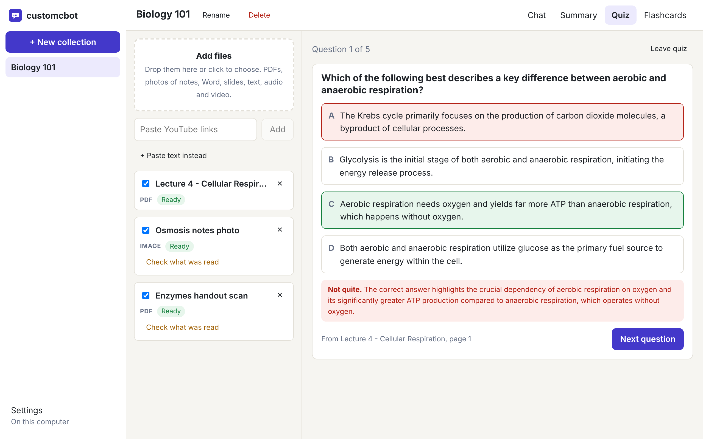
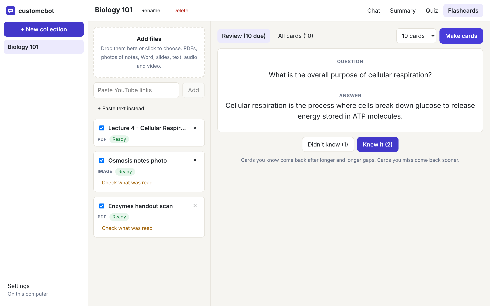
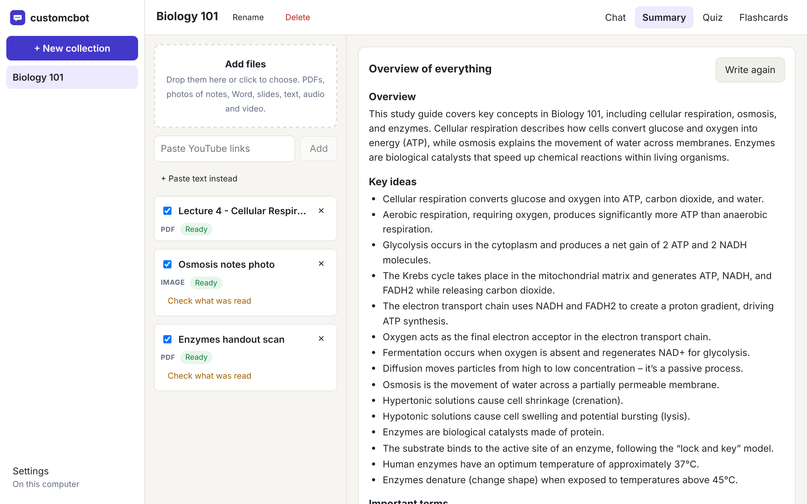
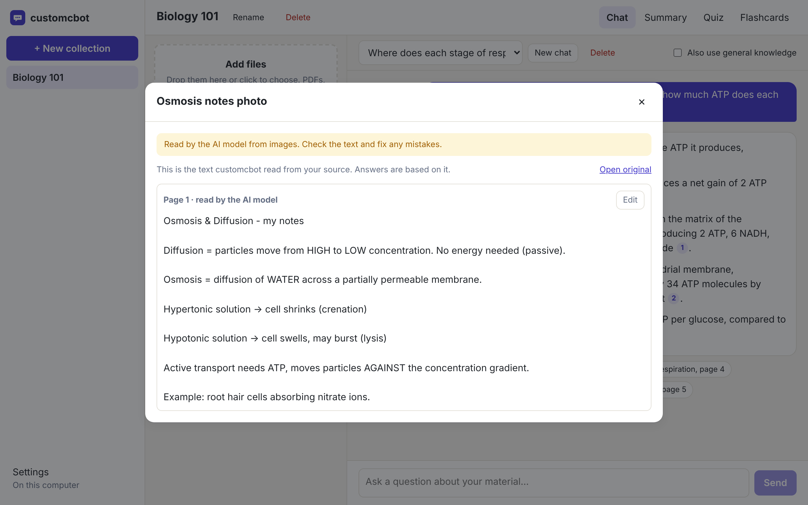
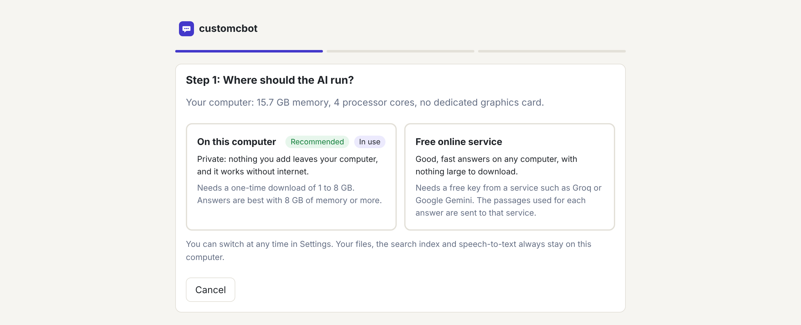
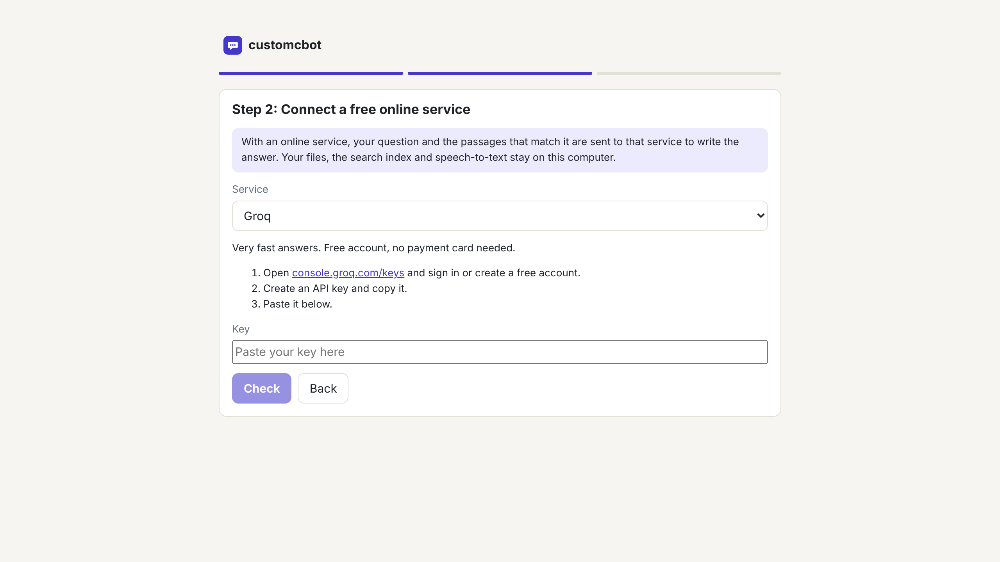

# customcbot

A free chatbot you teach with your own material. Add PDFs, lecture videos, slides or photos of handwritten notes, then ask questions, get study guides, and revise with quizzes and flashcards.

It is free either way you run it:

- **On your own computer**, with a local AI model. Private and offline; nothing you add leaves your machine.
- **With a free online AI service** such as Groq or Google Gemini. Good answers even on an old laptop; you paste in a free key.

You choose on first start and can switch at any time.


## What it does

- **Chat with your material.** Answers come from what you added, and each one links back to the exact page or video moment it came from.
- **Reads many formats.** PDF (including scans), Word, PowerPoint, text, images and photos of handwriting, audio and video files, and YouTube links or playlists.
- **Summaries.** A study guide for one source, or one overview of a whole collection.
- **Quizzes.** Multiple choice or written answers, drawn from across your material, with explanations.
- **Flashcards.** Written for you, with spaced repetition so the cards you miss come back sooner.
- **Collections.** Keep each subject or project separate: 5 PDFs and 10 lectures for one course, a manual and some notes for another.

It is built for studying but works for anything you want to ask questions about: manuals, reports, meeting recordings, research papers.

| | |
|---|---|
|  |  |
|  |  |

## Get started

New to this? The **[step-by-step guide](docs/GUIDE.md)** walks through every screen, from download to your first quiz.

**What you need:** Windows, macOS or Linux, an internet connection for the first start, and about 2 GB of free disk space (more if you choose a local AI model). You do not need to install Python or anything else first; the start file does it for you.

**1. Download customcbot.** Click the green **Code** button on this page, choose **Download ZIP**, and unzip it. (Or `git clone` this repository.)

**2. Start it.**

- **Windows:** double-click `start.bat`. If a blue "Windows protected your PC" box appears, click **More info**, then **Run anyway**.
- **macOS or Linux:** open a terminal in the folder and run:

  ```bash
  ./start.sh
  ```

  If it says "permission denied", run `chmod +x start.sh` once and try again.

The first start takes a few minutes while it downloads about 1 GB of parts. Your browser then opens the app at `http://localhost:8765`.

**3. Choose where the AI runs.** The setup page looks at your computer and recommends one of the two options below.



**4. Your first five minutes.**

1. Click **+ New collection** and name it, for example "Biology 101".
2. Drop a PDF on **Add files**, or paste a YouTube link, and wait until it says **Ready**.
3. In the **Chat** tab, ask a question about it. Click a number in the answer to see the page it came from.
4. Open the **Quiz** tab and click **Make quiz**.
5. Open the **Flashcards** tab and click **Make cards**.

To stop customcbot, close the terminal window. To start it again, run the same file.

**Updating:** download the new ZIP (or `git pull`) and start it as before. Your collections are kept, because they live in a separate data folder. **Uninstalling:** delete the app folder and the data folder; the [guide](docs/GUIDE.md#8-your-data-where-it-is-backup-removal) says where it is.

## Option A: on your own computer

Best for privacy, and it works without internet. You need about 8 GB of memory for good answers and 1 to 8 GB of free disk space. A graphics card is not required.

Install [Ollama](https://ollama.com/download), the free program that runs the model, and open it once. The setup page then offers these sizes and downloads the one you pick:

| Size | Download | Memory needed | Good for |
|---|---|---|---|
| Lite | 0.8 GB | 4 GB | Very old or low-memory computers only. Fast, but answers are noticeably weaker: it rambles and can make things up. Reads typed and printed text only. |
| Standard | 3.4 GB | 8 GB | Most laptops. Clear answers with correct sources, and reads handwriting and scanned pages. |
| Plus | 8.2 GB | 16 GB and a graphics card or Apple Silicon | The best local answers. Slow without a graphics card. |

All three use Google's open Gemma 3 models through Ollama. You can also enter any other Ollama model under "Use a different Ollama model".

If your computer has less than about 7 GB of memory, use Option B instead: it will give much better answers than Lite.

## Option B: a free online service

Best for older computers: nothing large to download, and answers are fast. You create a free account at one service, copy a key, and paste it into the setup page, which links you to the right place. The [guide](docs/GUIDE.md#option-b-a-free-online-service) shows each step for Groq, which is the service this app was tested with.



| Service | Notes |
|---|---|
| [Groq](https://console.groq.com/keys) | Very fast. Free account, no payment card. |
| [Google Gemini](https://aistudio.google.com/apikey) | Generous free allowance, and can read handwriting and scans. |
| [OpenRouter](https://openrouter.ai/keys) | One key for many free models. Lower daily limits. |
| [Cerebras](https://cloud.cerebras.ai) | Very fast, with a daily allowance. |
| [Mistral](https://console.mistral.ai/api-keys) | European service with a free plan. |
| [FreeLLMAPI](https://github.com/tashfeenahmed/freellmapi) | A router you run yourself that spreads requests over many free services. Start it, then use its address and key. |
| Another service | Any address that speaks the OpenAI chat API, such as LM Studio or llama.cpp on your network. |

What to know before choosing this:

- **What is sent.** Your question and the passages that match it go to the service to write the answer. If you turn on image reading, the page images go too. Your files, the search index and speech-to-text stay on your computer.
- **Free plans have limits** per minute and per day, and they change. customcbot waits out short limits by itself. If a day's allowance runs out, wait, pick another model in Settings, or switch to a local model.
- **Some free plans may use your requests to improve their models.** Check the service's terms if your material is sensitive, or use Option A.
- **Model names change.** customcbot asks the service which models it has right now and suggests one, so there is nothing to type.

## Tips for good answers

- **Check what was read.** For handwriting, scans and speech, click a source to see the text customcbot extracted. Fix any mistakes there and the answers improve straight away.
- **Tick the sources you want.** The checkboxes on the left limit chat, quizzes and flashcards to those sources.
- **Ask specific questions.** "What are the three stages of cellular respiration?" works better than "tell me about biology".
- **"Also use general knowledge"** lets the model add things that are not in your material. It marks those parts clearly. Leave it off when accuracy to your sources matters.

## What to expect

Small models running on a home computer are slower and less capable than large online services. With a local model:

- On a laptop without a graphics card, an answer takes from a few seconds to a minute. Summaries and quizzes run in the background and can take several minutes for long material.
- Answers are limited to the passages customcbot finds for your question. If it says it could not find something that is in your material, rephrase the question using words from the source.
- The model can still make mistakes. Use the citations to check anything important.
- Handwriting needs the Standard size or larger, or an online model that reads images. Messy handwriting will have errors.
- Follow-up questions such as "and the next stage?" work, but small local models sometimes pick the wrong thing to continue from. Asking the full question is more reliable.
- YouTube videos need captions, or customcbot downloads the audio and transcribes it, which is slow. YouTube also blocks some networks, such as VPNs and cloud servers.

## Privacy

**With a local model**, your files, questions and answers stay in a folder on your computer. customcbot contacts the internet only to download models during setup, and to fetch captions or audio for YouTube links you add.

**With an online service**, the question you ask and the passages found for it are also sent to the service you chose, each time you chat or make a summary, quiz or flashcards. Your key is stored in the data folder on your computer and is never shown again in the browser.

There is no account and no tracking in customcbot itself. The data folder is shown in the terminal when the app starts. Delete that folder to remove everything.

## Troubleshooting

| Problem | What to do |
|---|---|
| The setup page keeps saying it is looking for Ollama | Open the Ollama app so it is running, then press "Check again". |
| "Not enough free memory" | Close other apps, or pick a smaller model size in Settings. |
| Answers are very slow | Choose a smaller model size, and set Memory use to Low in Settings. |
| "did not accept the key" | Copy the whole key again from the service's website, or create a new one. |
| "The free allowance ... is used up for now" | Wait a while, pick another model in Settings, or switch to a local model. |
| A YouTube link fails | Check the video is public. If you are on a VPN, turn it off and press "Try again". |
| `start.sh` says "permission denied" | Run `chmod +x start.sh` once, then try again. |

## How it works

customcbot does not retrain a model on your files, which would take hours and a powerful machine. It uses retrieval instead:

1. Each source is turned into text: PDF text is extracted, scanned pages and handwriting are read by a vision model, speech is transcribed.
2. The text is split into passages, each labelled with its page or timestamp.
3. Every passage is indexed twice: by meaning, using a small embedding model, and by exact words, using SQLite full-text search.
4. When you ask a question, both indexes are searched, the results are merged, and the best passages are given to the language model with instructions to answer from them and cite them.

Summaries, quizzes and flashcards use the same passages.

| Part | Built with |
|---|---|
| Language and vision model | [Ollama](https://ollama.com) running Gemma 3, or any service that speaks the OpenAI chat API |
| Search by meaning | [fastembed](https://github.com/qdrant/fastembed) with a multilingual MiniLM model, on the CPU |
| Storage and keyword search | One SQLite file |
| PDFs, OCR, speech | pypdfium2, RapidOCR, faster-whisper |
| Server and interface | FastAPI; Preact with no build step |

## For developers

```bash
uv sync
```

```bash
uv run pytest
```

```bash
uv run ruff check .
```

The tests use a stand-in model, so they need neither Ollama nor a network connection. To click through the interface with that stand-in model:

```bash
CUSTOMCBOT_FAKE=1 uv run customcbot
```

To try the online option without a real account, start the stand-in service and connect to it as "Another service" with the address `http://127.0.0.1:9911/v1` and the key `test-key`:

```bash
uv run python -m tests.standin 9911
```

Useful places in the code:

- `src/customcbot/api/routers/`: the web routes, one file per kind of thing.
- `src/customcbot/domain/`: collections, sources and chats as objects.
- `src/customcbot/database/`: storage, search, and the numbered files that change the tables.
- `src/customcbot/ai/`: the model clients, the local model sizes and the list of online services (`catalog.py`).
- `src/customcbot/graphs/`: the multi-step workflows (reading a source, chat, quiz, flashcards, summaries).
- `src/customcbot/commands/`: background work.
- `src/customcbot/prompts/`: every instruction sent to the model, one template per file.
- `src/customcbot/ingest/`: one file per kind of source.
- `src/customcbot/web/`: the interface. Edit and reload; there is nothing to compile.

Settings by environment variable: `CUSTOMCBOT_DATA_DIR` (where data is stored), `OLLAMA_HOST` (if Ollama runs somewhere else) and `CUSTOMCBOT_API_KEY` (the key for an online service, instead of saving it in Settings).

### Running with Docker

```bash
docker compose up
```

This starts Ollama and customcbot together at `http://localhost:8765`.

customcbot is a single-user app with no login. Do not put it on the public internet as it is. A shared, hosted version would need user accounts, separate data per user and a server with a graphics card; that is not built yet.

## Licence

MIT. See [LICENSE](LICENSE). Bundled browser libraries are listed in [`src/customcbot/web/vendor/README.md`](src/customcbot/web/vendor/README.md).
