# customcbot user guide

This guide takes you from nothing installed to chatting with your own material, step by step. If you only want the short version, see the [README](../README.md#get-started).

**Contents**

1. [What you need](#1-what-you-need)
2. [Download and start](#2-download-and-start)
3. [Set up: choose where the AI runs](#3-set-up-choose-where-the-ai-runs)
4. [Add your material](#4-add-your-material)
5. [Ask questions](#5-ask-questions)
6. [Summaries, quizzes and flashcards](#6-summaries-quizzes-and-flashcards)
7. [Change the model or switch between local and online](#7-change-the-model-or-switch-between-local-and-online)
8. [Your data: where it is, backup, removal](#8-your-data-where-it-is-backup-removal)
9. [Updating and uninstalling](#9-updating-and-uninstalling)
10. [If something goes wrong](#10-if-something-goes-wrong)

## 1. What you need

- A computer with Windows, macOS or Linux.
- An internet connection for the first start. It downloads about 1 GB of parts the app needs.
- Free disk space: about 2 GB for the app, plus 1 to 8 GB more if you choose a local AI model.
- You do **not** need to install Python or anything else first. The start file does that for you.

Two things are optional and come up during setup:

- **Ollama**, a free program, if you want the AI to run on your own computer.
- **A free key** from a service such as Groq, if you want to use an online AI instead.

## 2. Download and start

**Step 1.** On the project's GitHub page, click the green **Code** button, then **Download ZIP**. Unzip the file somewhere you will find it again, for example your Documents folder.

**Step 2.** Start it.

**Windows**

1. Open the unzipped folder and double-click `start.bat`.
2. If a blue box says "Windows protected your PC", click **More info**, then **Run anyway**. Windows shows this for any downloaded script it does not know.
3. A black window opens and shows progress. Leave it open: it is the app running.

**macOS or Linux**

1. Open a terminal in the unzipped folder. On macOS: right-click the folder in Finder and choose **New Terminal at Folder**.
2. Run:

   ```bash
   ./start.sh
   ```

3. If it says "permission denied", run this once and then try again:

   ```bash
   chmod +x start.sh
   ```

**What you should see.** The first start takes a few minutes. When it is ready, the window prints something like this, and your browser opens the app:

```
  customcbot 0.1.0 is running at http://localhost:8765
  Your data is stored in ...
  Press Ctrl+C to stop.
```

If the browser does not open by itself, open it and go to `http://localhost:8765`.

**To stop the app**, close that window. **To start it again**, run the same file; later starts take a few seconds.

> The start files are run automatically on Windows, macOS and Linux test machines for every change, from a fresh download and with nothing installed. If yours still fails while "Installing uv", install uv yourself from [docs.astral.sh/uv](https://docs.astral.sh/uv/getting-started/installation/), then run `uv run --no-dev customcbot` in the folder.

## 3. Set up: choose where the AI runs

The first screen asks **"Where should the AI run?"** and marks one choice as Recommended for your computer.

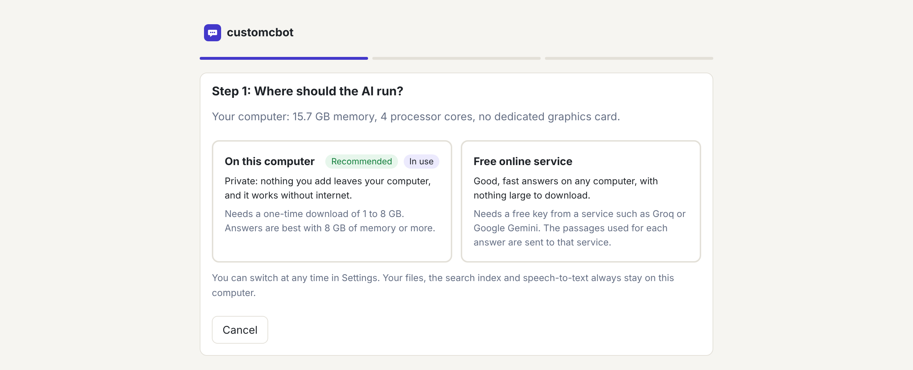

| | On this computer | Free online service |
|---|---|---|
| Privacy | Nothing leaves your computer | Your question and the matching passages are sent to the service |
| Speed | Seconds to a minute per answer without a graphics card | About 1 to 3 seconds per answer |
| Needs | 8 GB of memory for good answers; a 1 to 8 GB download | A free account and key; an internet connection |
| Works offline | Yes | No |

You can switch later in Settings, so pick whichever is easier to start with.

### Option A: on this computer

1. Click **On this computer**.
2. If the page says "Install Ollama": download it from [ollama.com/download](https://ollama.com/download), install it, and open it once. The page notices by itself and moves on. If it does not, press **Check again**.
3. Choose a model size. One is marked **Recommended** for your computer:
   - **Lite** only if you have less than 8 GB of memory. Its answers are noticeably weaker.
   - **Standard** for most laptops.
   - **Plus** if you have 16 GB of memory and a graphics card or an Apple Silicon Mac.
4. Click **Download and continue** and wait. This happens once.
5. When it says **All set**, click **Start**.

### Option B: a free online service

These steps use **Groq**, which needs no payment card and is the service this app was tested with.

1. Click **Free online service**. The service list already shows Groq.
2. Open [console.groq.com/keys](https://console.groq.com/keys) in a new tab. Sign in, or create a free account.
3. Click **Create API Key**, give it any name, and copy the key it shows. It starts with `gsk_`. You can only see it once, so copy it now.
4. Back in customcbot, paste the key into the **Key** box and click **Check**.
5. A green line says "Connected" and a **Model** list appears with one model already chosen and marked "(suggested)". Keep it unless you know you want another.
6. Click **Use this service**, wait a moment, then click **Start**.

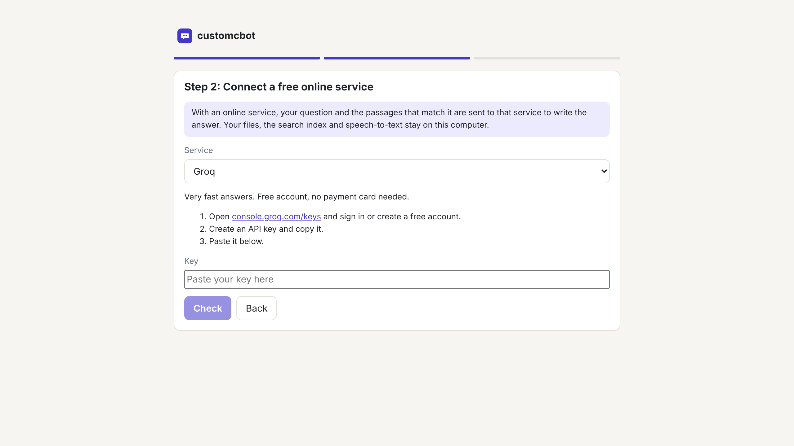

Other services work the same way; only the place you get the key differs:

| Service | Where to get the key | Good to know |
|---|---|---|
| Google Gemini | [aistudio.google.com/apikey](https://aistudio.google.com/apikey) | Can read handwriting and scans. Keep the "This model can read images" box ticked. |
| OpenRouter | [openrouter.ai/keys](https://openrouter.ai/keys) | Only its free models are listed. Lower daily limits. |
| Cerebras | [cloud.cerebras.ai](https://cloud.cerebras.ai) | Very fast, with a daily allowance. |
| Mistral | [console.mistral.ai/api-keys](https://console.mistral.ai/api-keys) | You may need to choose the free plan first. |
| FreeLLMAPI | Its own dashboard | Start FreeLLMAPI first, then use the key that starts with `freellmapi-`. The address is filled in for you. |
| Another service | Wherever it is hosted | Type its address, for example `http://localhost:1234/v1` for LM Studio. Leave the key empty if it needs none. |

Of these, only Groq has been tested with a real account. The others use the same connection method, so they should work, but small differences are possible.

**About the "This model can read images" box.** Tick it only if the model you chose can look at pictures. customcbot then sends photos of handwriting and scanned pages to the service to be read. If you leave it unticked, pictures are read on your computer, which works for printed text but not for handwriting.

## 4. Add your material

**Step 1. Create a collection.** A collection holds everything for one subject or project. Click **+ New collection**, type a name such as "Biology 101", and click **Create**.

**Step 2. Add sources.** Use the panel on the left:

- **Files:** drop them on the **Add files** box, or click it to choose. PDFs, photos of notes, Word, PowerPoint, text, audio and video all work. You can add many at once.
- **YouTube:** paste one or more links into **Paste YouTube links** and click **Add**. A playlist link adds every video in it.
- **Text:** click **+ Paste text instead** to paste notes directly.

**Step 3. Wait for "Ready".** Each source shows what is happening to it and then a green **Ready**. Typed PDFs take seconds. Scans, handwriting, and audio or video without captions take longer, because every page or minute has to be read or listened to.

**Step 4. Check what was read (for scans, handwriting and speech).** These sources get a **Check what was read** link. Click it to see the text customcbot extracted.

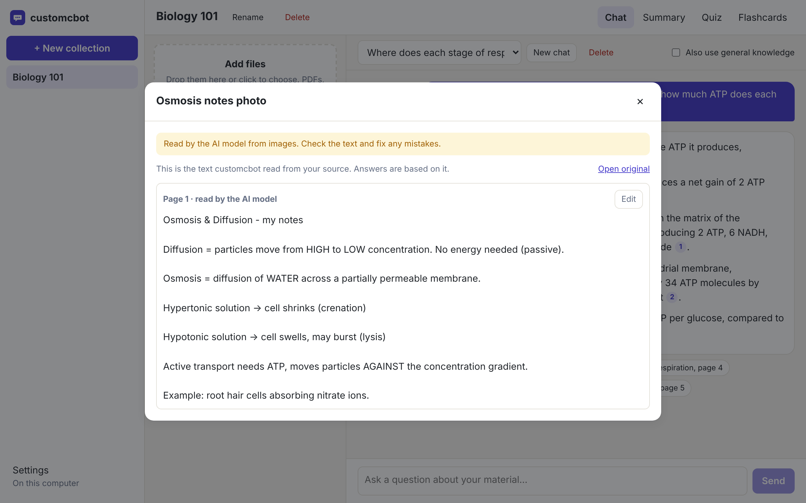

If something was misread, click **Edit**, fix the text, and click **Save**. Answers use the corrected text straight away. **Open original** shows the file you added.

To remove a source, click the **✕** next to it.

## 5. Ask questions

Open the **Chat** tab, type your question in the box at the bottom, and press Enter or click **Send**.

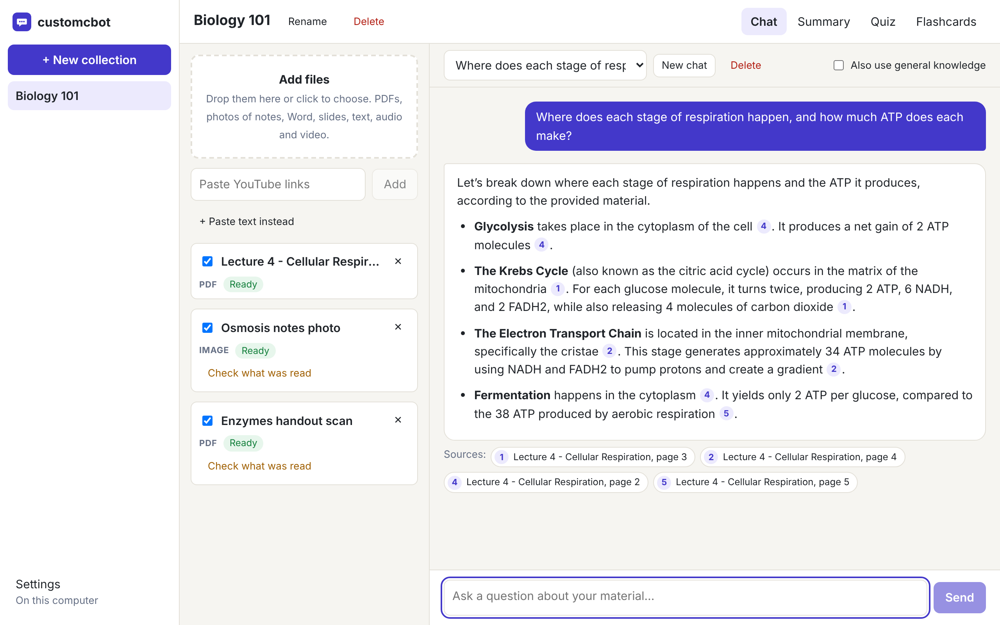

- **Numbers in the answer are sources.** Click a number, or one of the entries under **Sources**, to see the exact passage the answer used, with its page number. For a YouTube video it links to the right moment.

  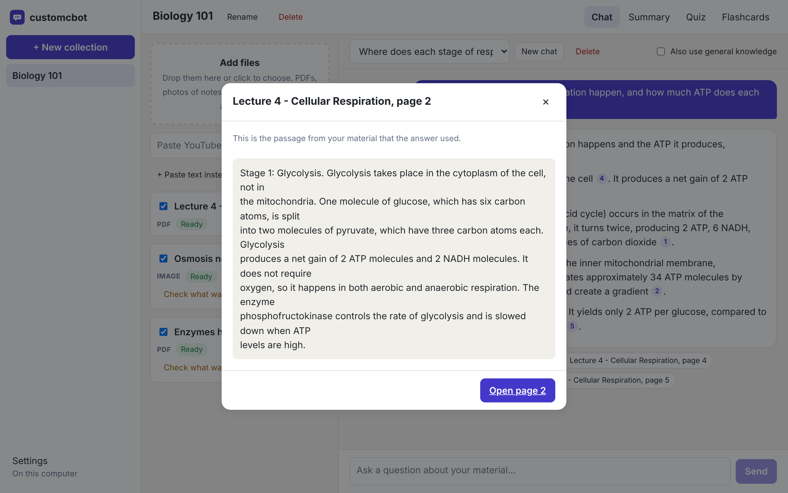

- **Limit the answer to some sources.** Untick sources on the left to leave them out. This also applies to quizzes and flashcards.
- **Follow-up questions work.** After asking about glycolysis you can ask "and the next stage?". If a follow-up is misunderstood, ask the full question instead.
- **"I could not find it in the material"** means the passages found for your question did not contain the answer. Try again using words that appear in your source.
- **Also use general knowledge** lets the AI add things that are not in your material. It marks those parts with "Beyond your material:". Leave it off when you need answers that stick to your sources.
- **New chat** starts a fresh conversation. Earlier ones stay in the list next to it.

The AI can still make mistakes. For anything important, open the citation and check.

### Keep an answer, or ask about one source

- **Save as note** under an answer copies it into the **Notes** tab, titled with your question.
- **Ask** next to a source on the left opens a chat that looks only in that source. A short source is read whole, so nothing in it is missed.

### Your study companion

The face beside each answer is Mio, the study companion. She answers in a friendly voice, says hello back when you greet her, and looks pleased or worried in quizzes. What she tells you still comes from your material, with the same sources under each answer.

Click her name at the bottom left to:

- **Rename her**, or turn her off. With her off, the app looks and answers as it did before.
- **See what she remembers about you.** When you mention your name, what you study, an exam date or a topic you find hard, she keeps it as a short line and uses it in later answers. You can add lines yourself, edit them, forget one, or forget everything. Untick "Remember things about me" to stop it.
- **Use your own character.** The window shows a folder. Put pictures named `neutral`, `happy`, `thinking` and `sad` (PNG, JPG, WebP or GIF) in it; one picture named `neutral` is enough.

Good to know:

- What she remembers is kept on your computer only. To find things worth remembering, your messages that mention you ("I", "my") are read a second time by the same model that answers you. With an online service, that goes to the service too.
- She notices facts in English, Spanish, French, Portuguese, Hindi and Chinese messages, and writes them down in English. In other languages, add them yourself.
- With the smallest local model (Lite), she greets and reacts, but answers are worded plainly, because that model answers worse when asked for a tone as well. It also notices fewer facts.

### Search tab

- **Find passages** looks through your sources, your notes and the results in the Summary tab. Choose **Words and meaning**, **Exact words only** or **Similar meaning only**, and tick what to look in. Click a result to read the passage.
- **Ask in depth** is for a question that needs more than one passage, such as a comparison. The AI plans a few searches, takes notes from each (open a step to read them), then writes one answer with numbered sources. It is slower than Chat. With the Lite local model it does a single search.

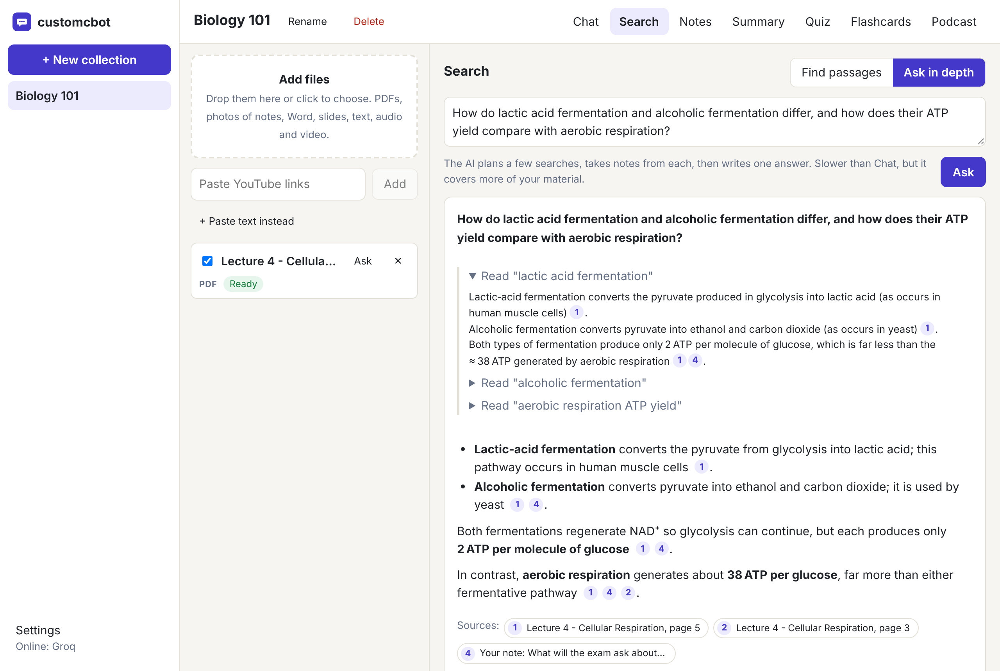

### Notes tab

**New note** opens an editor; Markdown works (`# heading`, `- list`, `**bold**`). A note without a title is named after its first line. Notes are searched together with your sources, so answers in Chat can use them and cite them as "Your note: …". Answers and results you saved are marked **saved answer**.

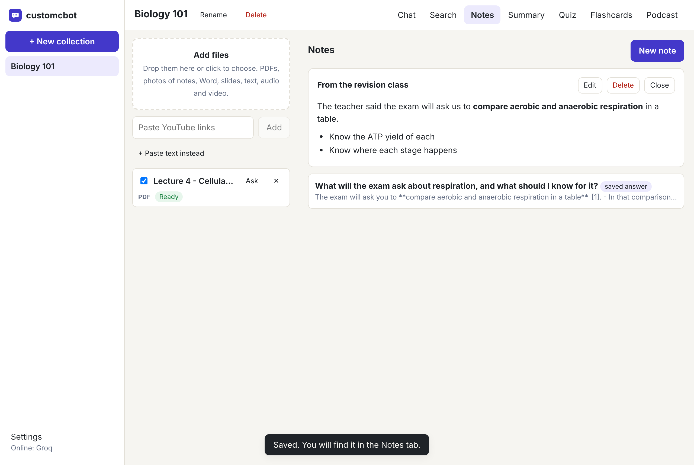

## 6. Summaries, quizzes and flashcards

All three are made from the sources ticked on the left. They run in the background, so you can keep using the other tabs while you wait.

### Summary tab

- **Write overview** writes one study guide covering all your sources: an overview, key ideas, important terms and questions to test yourself.
- Under **By source**, pick a task for a source and press **Make**. Five tasks are ready: **Study guide**, **Key points**, **Glossary**, **Revision questions** and **Explain it simply**. Click a result's name to open it. **Save as note** copies it into your notes; **Delete** removes it.
- **Edit tasks** lets you change the wording of a task, put a built-in one back to its original wording, add your own (for example "List every date in order with what happened"), or tick **Do this by itself for every new source**.

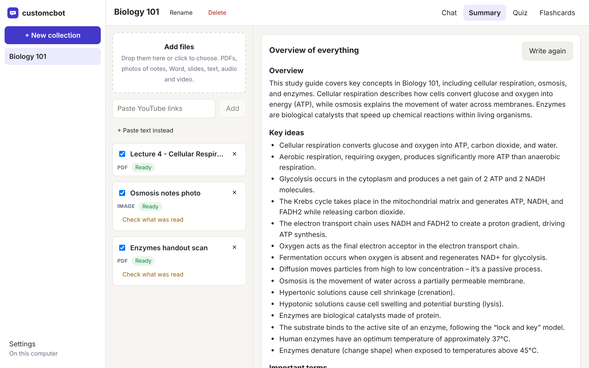

### Quiz tab

1. Choose how many questions and the type: **Multiple choice**, **Written answers (checked by the AI)**, or **A mix of both**.
2. Click **Make quiz**.
3. Answer each question. You see at once whether you were right, a short explanation, and which page the question came from. For written answers, type your answer and click **Check answer**.
4. Click **Next question**, and **See results** at the end.

Your quizzes are saved under **Your quizzes**, so you can take them again.

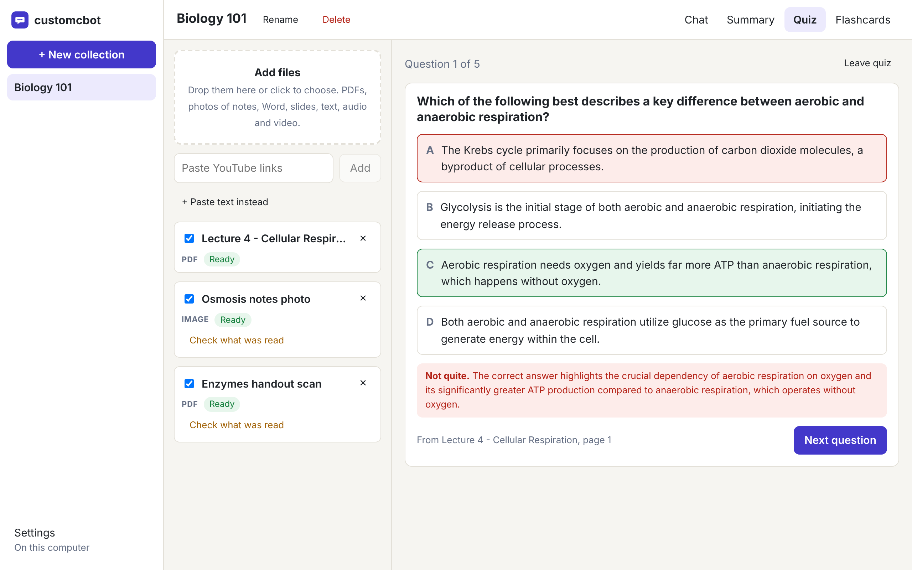

### Flashcards tab

1. Choose how many cards and click **Make cards**.
2. In **Review**, read the question, then click the card or press Space to show the answer.
3. Click **Knew it** or **Didn't know** (or press 2 or 1).

Cards you know come back after longer and longer gaps. Cards you miss come back sooner. **All cards** lists every card, where you can edit or delete them.

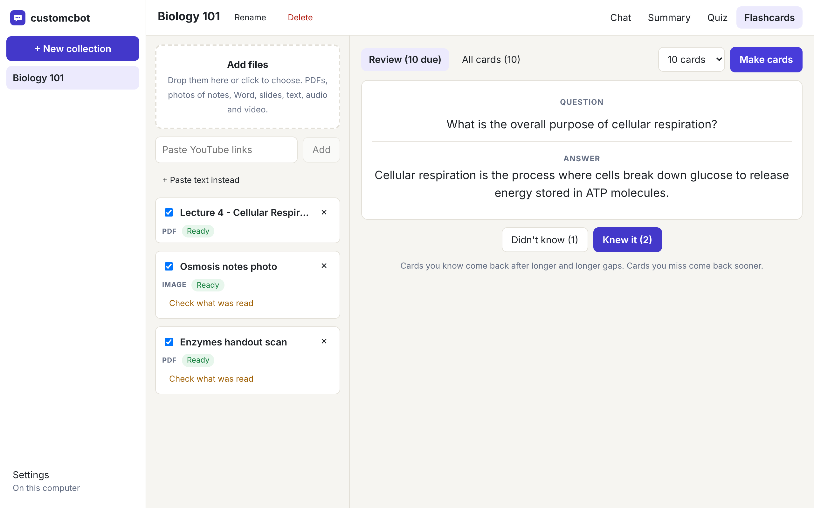

### Podcast tab

Turns your material into a spoken episode you can listen to.

1. Choose a **Kind of episode**: **Study recap** (two voices talk through the key ideas), **Quick overview** (one voice, shorter) or **Exam drill** (questions and answers).
2. Optionally type what to focus on, then press **Make episode**.
3. When it is ready, press play, **Download MP3**, or **Read the script**.

The first episode downloads the voices (about 350 MB, once). After that an episode of about four minutes takes one to two minutes with an online model, and around five minutes with a local model on a laptop. The script is written by the AI you chose; the voices run on your computer, so no audio is sent anywhere.

**Kinds and voices** lets you change who speaks (one to four speakers, each with a name, a voice and a short description) and what an episode should be like. The English voices are the best tested; Spanish, French, Hindi, Italian and Portuguese voices are included.

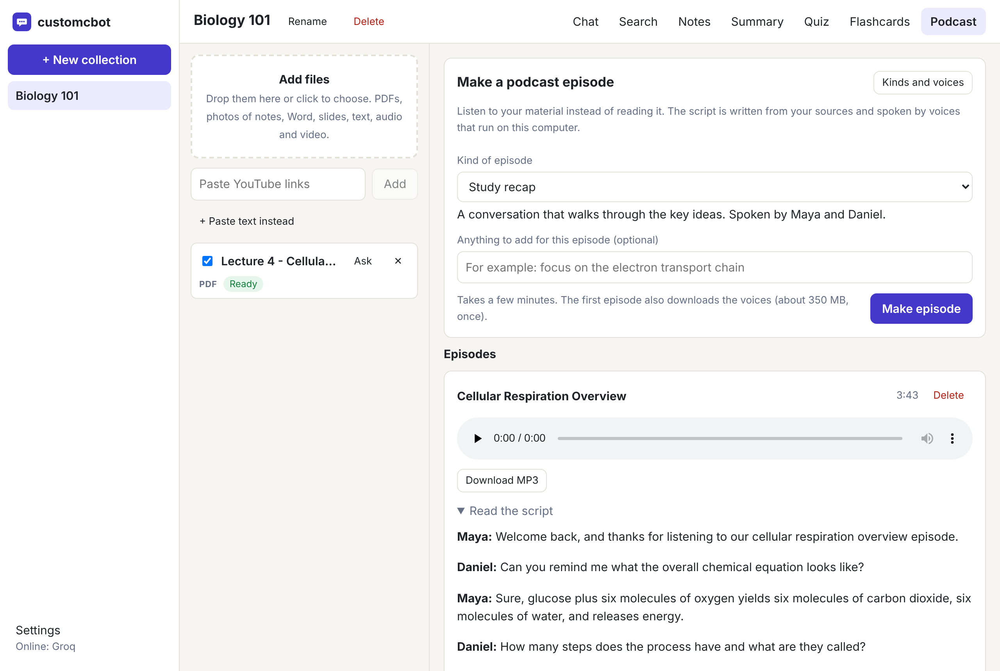

## 7. Change the model or switch between local and online

Click **Settings** at the bottom left. The line under it always shows where answers currently come from.

- **Change** reopens the setup screen. Pick the other option to switch between your computer and an online service, or pick the same one to choose a different model. A saved key is kept, so you do not need to paste it again.
- **Memory use** (local only): choose Low if answers are slow or the computer runs out of memory.
- **Speech-to-text quality:** Fastest, Balanced or Most accurate, for videos without captions and audio files.

Your collections and sources are unaffected by switching.

### Several services, and a model for each kind of work

**Services and models** in Settings is for when one model is not enough. Under **Which model does what** you can give different work to different models: answering questions; summaries, quizzes and flashcards; reading handwriting and scanned pages. A common choice is a fast model for chat and a larger one for quizzes, or an online model that reads images next to a local one for everything else. **Add a service** saves another service and its key; **Add a model** lists what that service offers and tests the one you pick before saving it. Keys are stored encrypted and are never shown again.

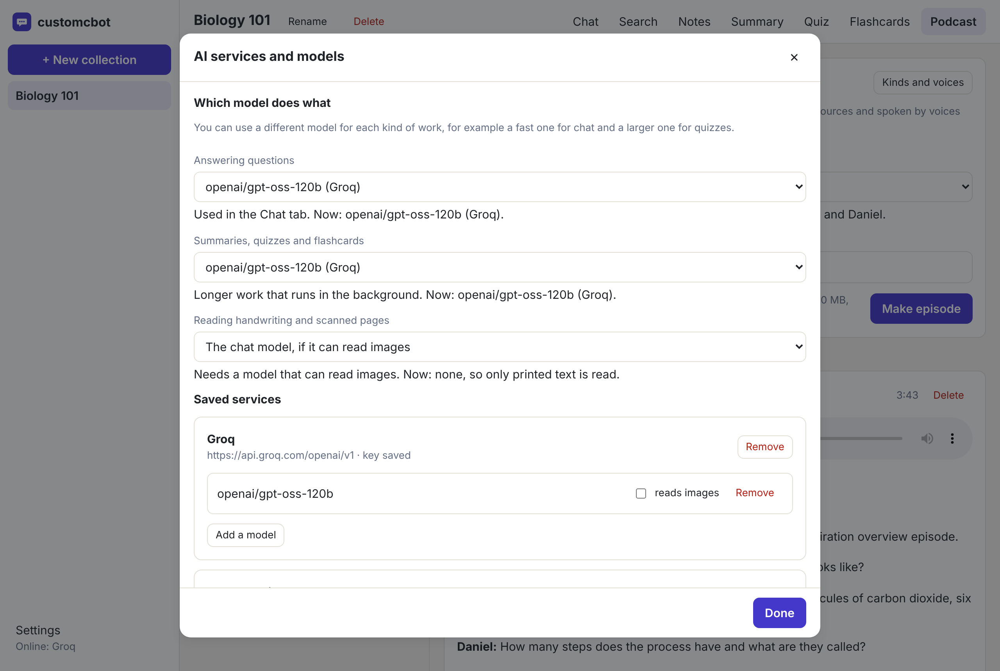

### Language and password

- **Language of the interface:** English, Español, Français, Português, हिन्दी or 中文. The translations were made by machine and have not been checked by native speakers. What the AI writes follows the language of your material and your questions, not this setting.
- **Password:** not needed while only this computer can open the app. If you start it for other devices (`--host 0.0.0.0`), press **Set a password**; every device then has to sign in. If you forget it, stop the app and start it once with `--reset-password`.

## 8. Your data: where it is, backup, removal

Everything you add is kept in one data folder on your computer. Its location is printed in the start window ("Your data is stored in ..."). Usually:

| System | Data folder |
|---|---|
| Windows | `C:\Users\<your name>\AppData\Local\customcbot` |
| macOS | `~/Library/Application Support/customcbot` |
| Linux | `~/.local/share/customcbot` |

- **Backup:** close the app, then copy that folder.
- **Move to another computer:** copy the folder to the same place on the new computer.
- **Remove everything:** close the app and delete the folder.

If you use an online service, your key is stored in this folder too. It is never shown again in the browser.

## 9. Updating and uninstalling

**Updating.** Download the new ZIP and unzip it, then start it as before. Your collections are kept, because the data folder is separate from the app folder. If you used `git clone`, run `git pull` in the folder instead.

**Uninstalling.** Delete the app folder, and the data folder from section 8. If you installed Ollama and no longer want it, remove it like any other program. Its downloaded models are kept in Ollama's own folder (`.ollama` in your user folder), which you can delete to free the space.

## 10. If something goes wrong

| What you see | What to do |
|---|---|
| "Windows protected your PC" | Click **More info**, then **Run anyway**. |
| `start.sh`: "permission denied" | Run `chmod +x start.sh` once, then try again. |
| The start window closes or stops while "Installing uv" | Install uv from [docs.astral.sh/uv](https://docs.astral.sh/uv/getting-started/installation/), then run `uv run --no-dev customcbot` in the folder. |
| The browser does not open | Go to `http://localhost:8765` yourself. If that port is in use, the start window shows the address it chose instead. |
| "Looking for Ollama..." never finishes | Open the Ollama app so it is running, then press **Check again**. |
| "Ollama is not running. Start Ollama and try again." | Same as above. Ollama must be open whenever you use a local model. |
| "Not enough free memory to run ..." | Close other programs, or choose a smaller size under Settings, **Change**. |
| Answers are very slow | Choose a smaller model size, set Memory use to Low, or switch to an online service. |
| "... did not accept the key" | Copy the whole key again from the service's website, or create a new one. |
| "The free allowance at ... is used up for now" | Wait a while, pick another model under Settings, **Change**, or switch to a local model. |
| "Could not reach ..." | Check your internet connection. |
| A source shows **Problem** | Read the message under it. Click **Try again** after fixing the cause, for example turning off a VPN for a YouTube link. |
| A scan or photo was read badly | Click **Check what was read** and correct the text. For handwriting, use the Standard local size or larger, or an online model that reads images. |
| The answer is wrong or says it could not find something | Open the citations to see what it used. Rephrase using words from your source, and check that the right sources are ticked. |

Still stuck? Open an issue on the project's GitHub page and include the message you saw and your operating system.
